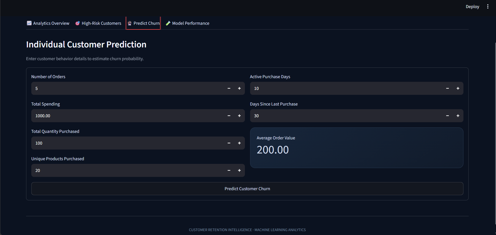

# Customer Retention Intelligence System

## Project Overview

The Customer Retention Intelligence System is a machine learning project that analyzes customer purchasing behavior and predicts customer churn risk. It includes a Streamlit dashboard for exploring customer retention, identifying high-risk customers, predicting churn, and reviewing model performance.

## Objectives

- Analyze customer purchasing patterns.
- Identify customers who may stop purchasing.
- Build and evaluate machine learning classification models.
- Explain important features associated with predicted churn risk.
- Present results through an interactive dashboard.

## Features

- **Customer Analytics:** Explore customer activity and purchasing behavior.
- **Churn Prediction:** Estimate churn risk using a trained classification model.
- **High-Risk Customer Analysis:** Identify customers who may need retention attention.
- **Model Evaluation:** Review classification metrics and confusion matrices.
- **Model Explainability:** Explore feature coefficients and their associations with churn.
- **Temporal Evaluation:** Evaluate model performance using historical observation cutoffs and subsequent prediction windows.

## Technology Stack

- Python
- Pandas and NumPy
- Scikit-learn
- Streamlit
- Plotly
- Matplotlib and Seaborn
- Joblib

## Dataset

This project uses the UCI Online Retail transactional dataset. The data contains invoice transactions, products, quantities, prices, dates, and customer identifiers.

The project cleans the transactions and aggregates them into customer-level features.

The original raw dataset and large intermediate datasets are excluded from this repository. Obtain the dataset from its original source and place the files in the expected project directories before rerunning the complete data pipeline.

## Machine Learning Approach

The project evaluates Logistic Regression and Random Forest classifiers.

The workflow includes:

1. Transaction data cleaning and validation.
2. Customer-level feature engineering.
3. Churn label generation based on a future purchase window.
4. Model training and validation.
5. Threshold selection using validation performance.
6. Final test evaluation.
7. Temporal evaluation using historical snapshots.
8. Feature coefficient analysis.

Logistic Regression was selected in the current evaluation based on validation ROC-AUC.

## Current Evaluation Results

The temporal test evaluation produced the following results:

| Metric | Result |
|---|---:|
| Accuracy | 64.30% |
| Balanced Accuracy | 67.29% |
| Precision | 55.32% |
| Recall | 88.84% |
| F1-score | 68.18% |
| ROC-AUC | 0.7426 |
| PR-AUC | 0.6303 |

These values reflect the current dataset, feature engineering, model configuration, and decision threshold. They should not be interpreted as guaranteed performance on future customer populations.

## Project Structure

```text
Customer-Retention-Intelligence/
├── app.py
├── requirements.txt
├── README.md
├── .gitignore
├── data/
│   └── processed/
│       └── customer_features.csv
├── models/
│   └── churn_model.joblib
├── reports/
│   ├── evaluation_comparison.csv
│   ├── final_evaluation_metrics.csv
│   ├── temporal_evaluation_metrics.csv
│   └── model_coefficients.png
└── src/
    ├── clean_data.py
    ├── build_customer_features.py
    ├── train_model.py
    ├── evaluate_model.py
    ├── evaluate_temporal_model.py
    ├── analyze_model.py
    └── compare_evaluations.py
```

## Installation

Create and activate a virtual environment, then install the dependencies.

```bash
python -m venv .venv
```

On Windows PowerShell:

```powershell
.\.venv\Scripts\Activate.ps1
```

Install the required packages:

```bash
python -m pip install -r requirements.txt
```

## Run the Dashboard

From the project root, run:

```bash
streamlit run app.py
```

The dashboard will open in your browser.

## Limitations

- The churn labels depend on the selected observation cutoff and future purchase window.
- Temporal evaluation provides an additional historical test, but it does not guarantee future production performance.
- Feature associations are not proof of causation.
- Predictions should support, rather than replace, business decisions about customer retention.

## Future Improvements

- Add more robust temporal backtesting.
- Compare additional classification models.
- Improve probability calibration and threshold selection.
- Add retention campaign recommendations.
- Deploy the dashboard online.


## Dashboard Screenshots

### 1. Analytics Overview


### 2. High-Risk Customers


### 3. Predict Churn


### 4. Model Performance

